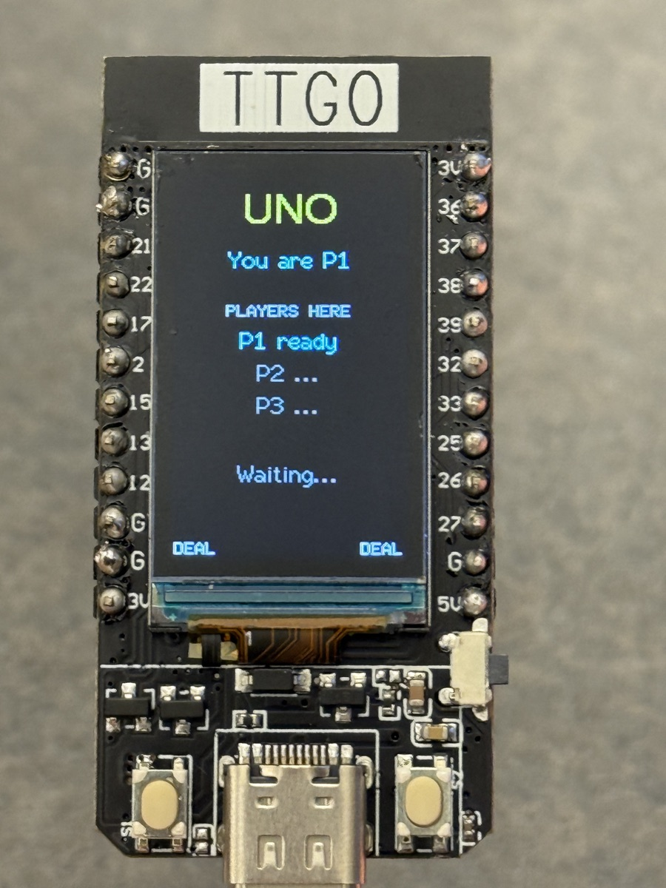

# Wireless UNO

UNO for 2–3 players on LILYGO T-Display boards over ESP-NOW.

Upload `graphuno.ino` as its own Arduino sketch with TFT_eSPI set up for your board. Use the same `TEAM_ID` on every board and a different `PLAYER_ID` (0–2) for each player.

Left cycles through cards or colors. Right plays, draws, or confirms a color.

[UNO rules](https://www.unorules.com/)

